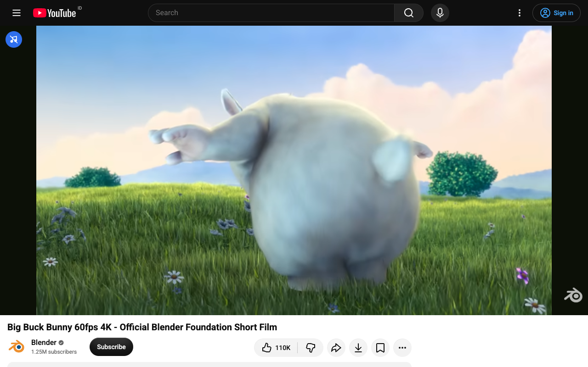

# Music Filter

[](https://github.com/HighWatersDev/music-filter/actions/workflows/ci.yml)

A browser extension that removes background music from YouTube videos while they play and keeps the voices. Everything runs on your device. Nothing is uploaded, and no account is needed.

## Where it runs

| Browser | How it filters |
|---|---|
| Chrome, Edge, Brave, Firefox on desktop | Live, with about 0.1 s of delay |
| Safari on iPhone, iPad and Mac | Ahead of playback. The video pauses briefly while the first seconds are filtered. |
| Firefox for Android | Ahead of playback, same as Safari |

Chrome on phones does not support extensions.



## Installing

Store listings for Chrome, Edge, Firefox and Safari are on the way. Until then, build from source and load `extension/` as an unpacked extension (see below).

## Using it

The filter is on by default and remembers your choice.

- **In the player:** a round music-note button shows in the top-left corner whenever YouTube shows its own controls. Tap or click it to turn the filter on or off.
- **From the browser:** click the Music Filter button in the toolbar for an on/off switch and the current status. On phones it's in the browser menu: ⋮ › Extensions in Firefox, the aA menu in Safari.

## What to expect

- Speech comes through clearly. Most music is removed, including music under speech. Some can remain at a low level.
- Sound effects and ambient sound are removed too. It keeps voices only.
- If filtering fails, the video is muted with a message. The original music never plays while the filter is on.

## Known limitations

- Singing is a voice, so sung vocals still come through.
- On Safari and Firefox for Android the filter works at normal speed only. At other speeds the video is muted.
- On Safari and Firefox for Android only Opus audio can be filtered. If YouTube serves AAC, the video is muted with "unsupported audio type".
- Phones filter a few seconds ahead of playback, so the video pauses briefly after it starts and after a seek. Phones slower than a Galaxy A56 may pause more often.

## How it works

YouTube streams audio to the page through Media Source Extensions. The extension copies that audio, decodes it, and runs [DPDFNet](https://huggingface.co/Ceva-IP/DPDFNet), a speech enhancement model, in WebAssembly.

- On desktop it filters live in an AudioWorklet.
- On Safari and Firefox for Android it filters in a Worker, a few seconds ahead of the playhead, and plays the result in sync with the video.

Design notes and test results are in [docs/](docs).

## Building from source

Requirements:
- Node 24
- For the WebAssembly engine: Rust (the version is pinned in `native/dpdf/rust-toolchain.toml`) and wasm-pack 0.15.0

```bash
npm ci
npm run fetch:models   # DPDFNet ONNX files from Hugging Face, checked by SHA-256
npm run build:dpdf     # Rust → extension/assets/dpdf_bg.wasm and vendor/dpdf/dpdf.js
npm run build          # bundles src/ into extension/dist
npm test
```

Load `extension/` as an unpacked extension for development. `npm run package` builds the store packages into `build/store/`. `npm run test:e2e` runs the browser tests with Playwright.

## Repository layout

| Folder | Contents |
|---|---|
| `src/` | Extension source: content scripts, the read-ahead pipeline, Workers and the AudioWorklet |
| `extension/` | The unpacked extension. `npm run build` writes `dist/` and the model step writes `assets/`. |
| `native/dpdf/` | Rust crate that runs DPDFNet with tract, built to WebAssembly |
| `test/` | Unit tests (`node --test`) and browser tests in `test/e2e/` |
| `tools/listen/` | Offline listening checks on audio files |
| `tools/store/` | Store screenshot capture |
| `tools/tiger-bench/` | Benchmark of the DBS-TIGER model in the browser, see `docs/spikes/` |
| `docs/` | Design notes, test results and store listing copy. [Index](docs/README.md). |

## Privacy

Music Filter collects no data. See [PRIVACY.md](PRIVACY.md).

## License

Apache-2.0. See [LICENSE](LICENSE) and [NOTICE](NOTICE) for third-party components, including the DPDFNet models by Ceva.
